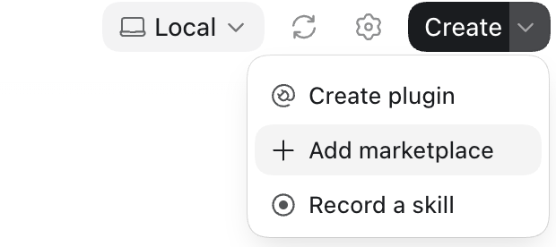
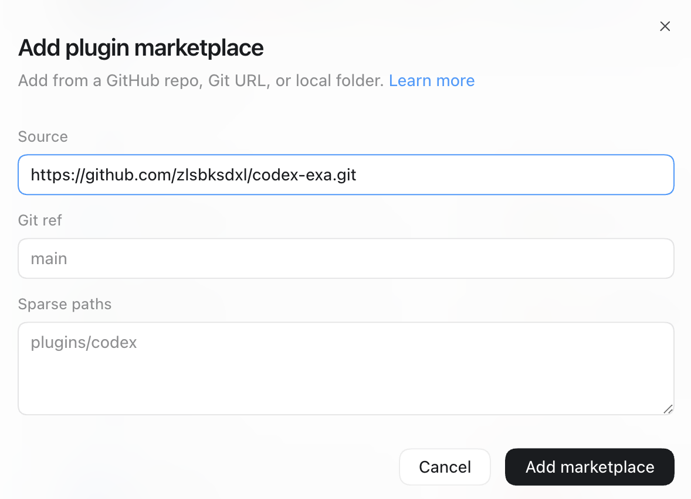

# Codex Exa

[English](README.md) | 简体中文

这是一个通过官方 [Exa MCP](https://github.com/exa-labs/exa-mcp-server) 服务提供实时网络搜索和网页全文读取的 Git-backed Codex Marketplace。

> 本仓库由社区维护，不代表 Exa 官方发布。

## 插件

| 插件 | 功能 | 额外要求 |
| --- | --- | --- |
| `exa` | 通过 Exa 搜索网络并获取网页全文；一般网络检索会优先调用 Exa | 通过浏览器 OAuth 连接 Exa 账号 |

## 在 Codex 中添加这个 Marketplace

### 桌面应用

1. 打开 **Codex → Plugins**。
2. 打开插件搜索框旁的 Marketplace 来源菜单，选择 **+ Add More**。

   

3. 粘贴本仓库地址：

   ```text
   https://github.com/zlsbksdxl/codex-exa.git
   ```

   

4. 选择 **Codex Exa**，打开 `exa` 并安装。

必须填写 Git 仓库 URL，不要填写原始 `marketplace.json` URL。Codex 会克隆仓库并自动发现 `.agents/plugins/marketplace.json`。

### CLI

```bash
codex plugin marketplace add \
  'https://github.com/zlsbksdxl/codex-exa.git' \
  --ref main \
  --sparse '.agents/plugins' \
  --sparse 'plugins'

codex plugin list --marketplace codex-exa --available --json
codex plugin add exa@codex-exa
```

安装后请完全重启 ChatGPT/Codex 桌面应用，并在新任务中使用插件，以便重新加载 Skill 和 MCP。

## 连接 Exa

插件使用 Exa 官方远程 MCP OAuth 地址。安装时或首次使用 Exa 时，Codex 会打开账号连接流程；登录 Exa 并确认授权即可，不需要在仓库或插件配置中保存 API Key。

## 更新

```bash
codex plugin marketplace upgrade codex-exa
codex plugin add exa@codex-exa
```

## 从原合并 Marketplace 迁移

原 `codex-plugins` Marketplace 已拆分为本仓库和 [codex-lark](https://github.com/zlsbksdxl/codex-lark)。如果旧 Marketplace 仍在配置中，请先移除其插件实例和来源：

```bash
codex plugin remove exa@codex-plugins
codex plugin remove feishu2codex@codex-plugins
codex plugin marketplace remove codex-plugins
```

然后按上面的命令添加 `codex-exa`，并根据 `codex-lark` 的 README 添加飞书插件。

## 仓库结构

```text
.
├── .agents/plugins/marketplace.json
└── plugins/
    └── exa/
```

## 上游与许可证

- [Exa MCP](https://github.com/exa-labs/exa-mcp-server), MIT
- 本仓库的打包和文档使用 [MIT License](LICENSE)

## 开发与校验

```bash
./scripts/validate-marketplace.sh
```

GitHub Actions 会对每次 push 和 pull request 执行同一结构校验。发布前还应使用 Codex 的 `plugin-creator` 和 `skill-creator` 校验器检查插件与 Skill。

安全问题请参阅 [SECURITY.md](SECURITY.md)。
